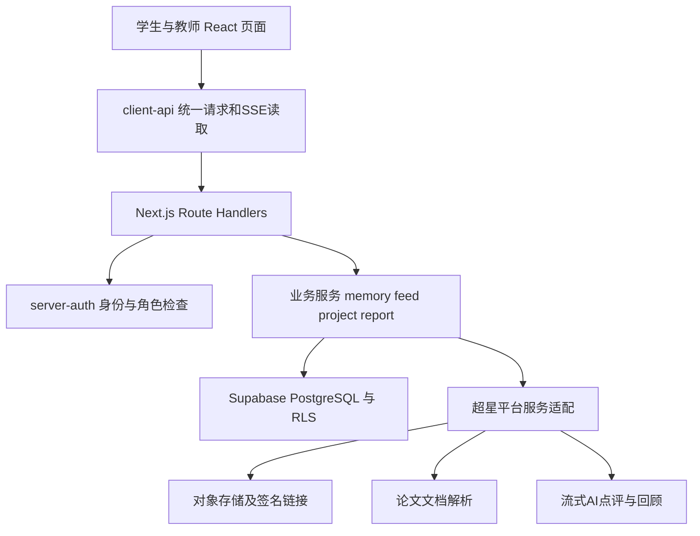

# 架构说明

采用模块化单体，而非为小型课程项目引入多个微服务。保留 Next.js App Router 作为页面与HTTP边界，业务规则与平台交互放入独立模块。

## 责任边界

1. 页面负责展示、用户输入和操作状态，不信任浏览器自行声明的教师身份。
2. HTTP接口负责解析请求、身份与资源授权、返回错误和流式事件。
3. `src/lib`负责业务组合，例如作品解包、材料归类、版本计数、最终成绩来源。
4. 数据库保留记录关系和RLS；对象存储保管图片、视频和论文二进制。
5. AI根据材料生成建议与文本，不作为身份授权机制，也不应按姓名调整成绩。

## 主要数据关系

`profiles`关联本人档案；`study_trips`表示研学；`stage_records`与`memory_checkins`保存过程；`reports`与`project_submissions`保存报告、作品与反馈；`posts`及点赞收藏评论表支持交流；`class_roster`仅保存经授权配置的名册。

学生记录按用户和研学关联，回顾按卡片关联。作品保持每人每趟一份最新状态，记录提交次数；历史最高AI分与教师评价有各自时间信息，重交后提示重新评价。

## 评分与材料链路

上传ZIP后先扫描归类，再写入对象存储并关联提交。论文解析后，AI读取正文、项目介绍及过程文本生成七维反馈。AI不直接识别图片和视频，不能声称已核验其中证据。最终展示保留“教师优先，否则AI最高分”的原项目口径；其教育合理性需由课程教师决定。

教师下载不是返回最初上传包，而是按记录中的fileId重建“论文/图片/视频/提交信息.txt”。当前实现逐文件读取后追加，虽输出ZIP流，单个大视频仍可能占用较多内存，后续应改用存储读取流并补充失败恢复测试。

## 后续模块化方向

当业务继续扩展时，可将`src/lib`按identity、memory、feed、submission、assessment分目录，并引入存储/解析/模型服务接口。当前优先保留可运行导出结构与路径兼容，避免无收益的大规模移动。
